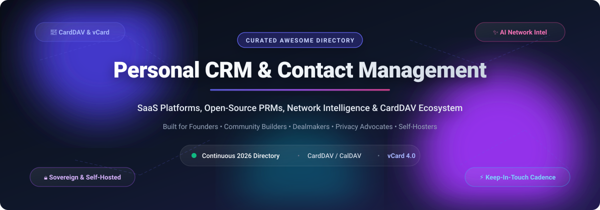

# 📇 Awesome Personal CRM & Contact Management Ecosystem 🤝

<p align="center">
  
</p>

<p align="center">
  <a href="https://github.com/ishandutta2007/Awesome-Awesome-Awesome"></a><a href="https://discord.gg/jc4xtF58Ve"></a>
  <a href="https://github.com/ishandutta2007/Awesome-Personal-CRM-Contact-Management"></a>
  <a href="https://github.com/ishandutta2007/Awesome-Personal-CRM-Contact-Management/fork"></a>
  <a href="https://github.com/ishandutta2007/Awesome-Personal-CRM-Contact-Management/graphs/contributors"></a>
  <a href="https://github.com/ishandutta2007/Awesome-Personal-CRM-Contact-Management/blob/main/LICENSE"></a>
  <a href="https://github.com/ishandutta2007"></a>
</p>

> **✨ A curated, comprehensive directory of Personal Relationship Managers (PRMs), Contact Management Systems (CMS), CardDAV/vCard sync engines, network intelligence platforms, and self-hosted open-source address books for founders, networkers, knowledge workers, and privacy advocates.**

---

## 📑 Table of Contents

- [🌐 Sector Overview & Market Dynamics](#-sector-overview--market-dynamics)
- [💼 SaaS & Hosted Personal CRM Platforms](#-saas--hosted-personal-crm-platforms)
- [🛠️ Open-Source GitHub Projects](#️-open-source-github-projects)
- [🔄 CardDAV, Contact Sync & CLI Tooling](#-carddav-contact-sync--cli-tooling)
- [🎯 How to Choose a Personal CRM Stack](#-how-to-choose-a-personal-crm-stack)
- [🤝 How to Contribute](#-how-to-contribute)
- [💖 Support & Sponsoring](#-support--sponsoring)
- [📈 Star History](#-star-history)
- [⚖️ Disclaimer](#️-disclaimer)

---

## 🌐 Sector Overview & Market Dynamics

The dedicated Personal CRM and Contact Management Software (CMS) sector is valued at approximately **$14.7 billion to $17.5 billion globally**, expanding at an estimated **11.5% to 12.1% CAGR** driven by the explosion of remote work, solo entrepreneurship, executive dealmaking, and AI-assisted networking. 

Unlike the traditional enterprise CRM industry (which is concentrated among mega-cap providers like Salesforce, Microsoft, and Oracle), the Personal CRM landscape is **moderately to highly fragmented**. There is no single "winner-take-all" incumbent because individual networking workflows vary drastically: knowledge workers and founders prefer customizable, canvas-like relational databases; angel investors and dealmakers demand deep automated communication graphs and email scraping; and privacy-focused self-hosters insist on sovereign, end-to-end encrypted CardDAV protocols.

---

## 💼 SaaS & Hosted Personal CRM Platforms

The following SaaS and cloud-hosted solutions are sorted by **Company Valuation / Market Cap (descending)**. Each product features specific starting tier prices and exact free tier or free trial limits.

| 🏢 Product | 💰 Valuation / Revenue Scale | 🏷️ Starting Pricing Tier | 🎁 Free Tier Limits / Free Trial Policy | 🚀 Key Focus & Capabilities |
| :--- | :--- | :--- | :--- | :--- |
| **[HubSpot](https://hubspot.com)** | **~$28B Market Cap** *(Public: HUBS, ~$3.1B ARR)* | **$15/user/month** (Starter tier billed annually, or $20/month billed monthly) | **Free forever plan**: Limited to **1,000 contacts**, up to 2 user seats, 1 deal pipeline, and 2,000 branded marketing emails/month. | Omnichannel inbound CRM, contact timeline tracking, meeting scheduler, document tracking, and sales pipelines. |
| **[Notion](https://notion.so)** | **$11B Valuation** *(~$600M ARR)* | **$10/user/month** (Plus tier billed annually, or $12/month billed monthly) | **Free forever plan**: **Unlimited blocks** for individual users (capped at **1,000 blocks** across shared workspaces), 5 MB file upload limit, up to 10 page guests, and 7-day page history. | Highly flexible relational databases, personal CRM templates, keep-in-touch cadence formulas, and cross-linked notes. |
| **[Clay](https://clay.com)** | **$7.1B Valuation** *(~$100M+ ARR)* | **$167/month** (Launch tier billed annually, or $185/month billed monthly) | **Free forever plan**: **100 data credits/month**, **500 actions/month**, max **200 rows per table**, unlimited seats, with waterfall enrichment and Claygent access. | AI-driven relationship mapping, multi-source contact enrichment, automated interaction logging from social media and email. |
| **[Affinity](https://affinity.co)** | **$600M Valuation** *(~$50M+ ARR)* | **$2,000/user/year** (Essential tier billed annually; ~$167/month equivalent) | **No free tier**: Sales demo & enterprise POC evaluation only; no public self-serve free trial. | Relationship intelligence engine built for VC, private equity, and institutional dealmakers with automated warm introduction paths. |
| **[Capsule CRM](https://capsulecrm.com)** | **~$7M Annual Revenue** *(Bootstrapped & profitable)* | **$18/user/month** (Starter tier billed annually, or $21/month billed monthly) | **Free forever plan**: Capped at **250 contacts**, up to **2 user seats**, 1 sales pipeline, and 5 custom fields per record. | Lightweight, straightforward contact organizer, interaction tracking, and pipeline management for freelancers and boutique teams. |
| **[Dex](https://getdex.com)** | **~$5M Annual Revenue** *(~$8M funding raised)* | **$12/user/month** (Premium tier billed annually, or $20/month billed monthly) | **7-day free trial**: Requires credit card upfront; unlocks full LinkedIn/email/calendar sync and up to 2,500 contacts before billing. No permanent free tier. | Dedicated personal CRM with automated LinkedIn sync, browser extension, custom reconnect cadences, and geolocation mapping. |
| **[Folk](https://folk.app)** | **~$4M ARR** *(Seed stage, backed by Accel)* | **$24/user/month** (Standard tier billed annually, or $30/month billed monthly) | **14-day free trial**: Full access to contact pipelines, multi-channel outreach, and email sync; no credit card required. No permanent free tier. | Collaborative contact manager combining spreadsheet agility with email campaigns, contact deduplication, and pipeline pipelines. |
| **[Monica Cloud](https://monicahq.com)** | **~$1M Annual Revenue** *(Indie SaaS / Self-host pioneer)* | **$9/month** (or $90/year billed annually) | **Free forever plan**: Capped at **30 contacts**, 100 MB file/attachment storage, and 1 vault. Self-hosting remains 100% free with unlimited contacts. | Purpose-built personal relationship manager tracking family, friends, gift ideas, relationship journals, and life milestones. |
| **[Cloze](https://cloze.com)** | **~$1M Annual Revenue** *(Early venture backed)* | **$17/month** (Pro tier billed annually, or $19.99/month billed monthly) | **14-day free trial**: Unrestricted trial of Pro/Business tiers (no credit card required); downgrades to a basic free plan with manual contact viewing and email client features. | AI-powered contact assistant that automatically synthesizes phone call logs, email threads, calendar events, and social activity into unified timelines. |

---

## 🛠️ Open-Source GitHub Projects

The following open-source Personal CRMs, contact databases, and modular PRM platforms are sorted by **GitHub Stars (descending)**. Each badge links directly to that repository's stargazers page.

| 📦 Repository | ⭐ Stars | 📝 Description & Architecture |
| :--- | :--- | :--- |
| **[AppFlowy](https://github.com/AppFlowy-IO/AppFlowy)** | [](https://github.com/AppFlowy-IO/AppFlowy/stargazers) | Open-source Flutter & Rust collaborative workspace and Notion alternative; ideal for building custom local-first Personal CRM boards, interaction tables, and contact journals. |
| **[NocoDB](https://github.com/nocodb/nocodb)** | [](https://github.com/nocodb/nocodb/stargazers) | Open-source Airtable alternative that turns any relational database (PostgreSQL, MySQL, SQLite) into an interactive smart spreadsheet for personal contact databases and CRM views. |
| **[Twenty](https://github.com/twentyhq/twenty)** | [](https://github.com/twentyhq/twenty/stargazers) | Modern open-source CRM built with TypeScript and NestJS (open alternative to Salesforce and Attio) with rich custom objects, Kanban views, and two-way email sync. |
| **[Joplin](https://github.com/laurent22/joplin)** | [](https://github.com/laurent22/joplin/stargazers) | Secure, open-source note-taking and knowledge organizer with end-to-end encryption; widely used for offline-first personal contact notes, CRM checklists, and interaction dossiers. |
| **[Huly Platform](https://github.com/hcengineering/platform)** | [](https://github.com/hcengineering/platform/stargazers) | Comprehensive open-source digital workspace featuring built-in contact management, team communication, project boards, and unified account profiles. |
| **[Monica](https://github.com/monicahq/monica)** | [](https://github.com/monicahq/monica/stargazers) | The premier open-source Personal Relationship Manager (PRM) built with PHP/Laravel. Tracks life events, debts, gifts, relationship histories, notes, and reconnect reminders. |
| **[Krayin CRM](https://github.com/krayin/laravel-crm)** | [](https://github.com/krayin/laravel-crm/stargazers) | Free, open-source Laravel-based CRM platform offering contact lifecycle tracking, activity logging, lead management, and custom Kanban workflows. |
| **[Teable](https://github.com/teableio/teable)** | [](https://github.com/teableio/teable/stargazers) | High-performance, real-time reactive spreadsheet database engine built natively on Postgres; excellent for scalable personal contact directories with full SQL power. |
| **[Grist Core](https://github.com/gristlabs/grist-core)** | [](https://github.com/gristlabs/grist-core/stargazers) | Modern open-source relational spreadsheet combining database integrity with Python formula support; exceptional for automated follow-up cadences and contact enrichment tables. |
| **[GetBindu](https://github.com/GetBindu/Bindu)** | [](https://github.com/GetBindu/Bindu/stargazers) | Open-source identity, communication, and decentralized personal relationship protocol designed for sovereign contacts and AI agent interactions. |
| **[Roundcube](https://github.com/roundcube/roundcubemail)** | [](https://github.com/roundcube/roundcubemail/stargazers) | Veteran browser-based IMAP and CardDAV contact management client in PHP with rich address book search, LDAP support, and vCard 3.0/4.0 export. |
| **[SimpleLogin](https://github.com/simple-login/app)** | [](https://github.com/simple-login/app/stargazers) | Open-source privacy and email shielding suite; enables users to assign unique email aliases per contact or service to keep contact management data sovereign. |
| **[Baserow](https://github.com/baserow/baserow)** | [](https://github.com/baserow/baserow/stargazers) | Open-source, no-code relational database built with Django and Vue; widely deployed for self-hosted Personal CRM schemas with webhooks and API triggers. |
| **[SuiteCRM](https://github.com/SuiteCRM/SuiteCRM)** | [](https://github.com/SuiteCRM/SuiteCRM/stargazers) | Battle-tested, enterprise-grade open-source CRM system providing full contact histories, relationship mapping, meeting logs, and self-hosted data ownership. |
| **[Radicale](https://github.com/Kozea/Radicale)** | [](https://github.com/Kozea/Radicale/stargazers) | Lightweight CalDAV and CardDAV server written in Python for hosting private, cross-device contact address books with minimal system overhead. |
| **[Mathesar](https://github.com/mathesar-foundation/mathesar)** | [](https://github.com/mathesar-foundation/mathesar/stargazers) | Intuitive open-source spreadsheet interface directly over PostgreSQL; provides non-technical users with an elegant UI to manage contacts, links, and interactions. |
| **[Erxes](https://github.com/erxes/erxes)** | [](https://github.com/erxes/erxes/stargazers) | Open-source Experience Operating System (XOS) combining contact management, unified customer communication channels, and sales pipelines in a self-hosted stack. |
| **[Frappe CRM](https://github.com/frappe/crm)** | [](https://github.com/frappe/crm/stargazers) | Clean, reactive open-source CRM built on the modern Frappe/Python framework with native lead pipelines, interaction logs, and omnichannel messaging. |
| **[EspoCRM](https://github.com/espocrm/espocrm)** | [](https://github.com/espocrm/espocrm/stargazers) | Fast, responsive open-source web CRM platform featuring comprehensive contact management, calendar/email synchronization, custom entities, and REST APIs. |
| **[Baïkal](https://github.com/sabre-io/Baikal)** | [](https://github.com/sabre-io/Baikal/stargazers) | Easy-to-administer lightweight CalDAV and CardDAV server built on `sabre/dav` for continuous cross-platform contact syncing across iOS, Android, and macOS. |
| **[DAVx⁵](https://github.com/bitfireAT/davx5-ose)** | [](https://github.com/bitfireAT/davx5-ose/stargazers) | Premier open-source Android synchronization client bridging self-hosted CardDAV servers (Radicale, Baïkal, Nextcloud) with native smartphone contact books. |
| **[vdirsyncer](https://github.com/pimutils/vdirsyncer)** | [](https://github.com/pimutils/vdirsyncer/stargazers) | Bidirectional command-line synchronization utility that synchronizes local `.vcf` vCard contact directories with remote CardDAV address books. |
| **[EteSync Server](https://github.com/etesync/server)** | [](https://github.com/etesync/server/stargazers) | End-to-end encrypted journal-based backend for sovereign, zero-knowledge contact, calendar, and task synchronization. |
| **[Cozy Stack](https://github.com/cozy/cozy-stack)** | [](https://github.com/cozy/cozy-stack/stargazers) | Open-source personal cloud platform in Go featuring contacts management, file syncing, and personal data aggregation in one self-hosted instance. |
| **[khard](https://github.com/lucc/khard)** | [](https://github.com/lucc/khard/stargazers) | CLI-first console CardDAV contact client written in Python; seamlessly integrates with terminal email clients like Mutt, Neomutt, and Aerc. |
| **[Nextcloud Contacts](https://github.com/nextcloud/contacts)** | [](https://github.com/nextcloud/contacts/stargazers) | Official open-source address book and CardDAV interface for Nextcloud Hub, supporting contact groups, vCard 4.0 format, and QR code sharing. |
| **[Monica Chandler](https://github.com/monicahq/chandler)** | [](https://github.com/monicahq/chandler/stargazers) | Next-generation rewrite of Monica Personal CRM focusing on improved modular architecture, enhanced performance, and unified contact lifecycles. |
| **[Abook](https://github.com/hhirsch/abook)** | [](https://github.com/hhirsch/abook/stargazers) | Classic, ultra-fast ncurses-based text mode address book utility engineered for minimalistic terminal workflows and plain-text contact databases. |
| **[lorey/personal-crm](https://github.com/lorey/personal-crm)** | [](https://github.com/lorey/personal-crm/stargazers) | Minimalist personal CRM tool designed to keep in touch with key relationships using lightweight scripts and reminders. |
| **[Bondery](https://github.com/usebondery/bondery)** | [](https://github.com/usebondery/bondery/stargazers) | Open-source modern personal CRM focused on meaningful relationship building, follow-up cadences, and personal notes. |
| **[harperreed/crm](https://github.com/harperreed/crm)** | [](https://github.com/harperreed/crm/stargazers) | Modern Personal CRM equipped with an MCP (Model Context Protocol) server, terminal TUI, web UI, and two-way Google Contacts/Calendar sync. |

---

## 🔄 CardDAV, Contact Sync & CLI Tooling

Building a resilient, sovereign personal address book often requires combining protocols and command-line synchronization tools:

```
+-------------------------------------------------------------------------------------------------------+
|                                  SOVEREIGN PERSONAL CRM ARCHITECTURE                                  |
+-------------------------------------------------------------------------------------------------------+
|  Mobile Devices (iOS / Android)  <--->  [DAVx⁵ Sync Client]  <--->  [Radicale / Baïkal CardDAV Server]|
|  Desktop / Terminal (Mutt/Aerc) <--->  [vdirsyncer / khard] <--->  Local .vcf / SQLite Address Book   |
|  Rich Relational Web Interface   <--->  [Monica / Twenty / NocoDB] <---> PostgreSQL Database          |
+-------------------------------------------------------------------------------------------------------+
```

- **[vdirsyncer](https://github.com/pimutils/vdirsyncer)**: Synchronizes contacts between remote CardDAV servers and local files for command-line access.
- **[DAVx⁵](https://github.com/bitfireAT/davx5-ose)**: Connects Android native contact apps with self-hosted CalDAV/CardDAV servers.
- **[khard](https://github.com/lucc/khard)**: Terminal-based contact browser and editor that reads local CardDAV vdir directories.
- **[Roundcube Webmail](https://github.com/roundcube/roundcubemail)**: Mature browser client for web-based contact books and email.

---

## 🎯 How to Choose a Personal CRM Stack

| 🎯 Use Case | 🏗️ Recommended Architecture | 💡 Key Advantages |
| :--- | :--- | :--- |
| **Founders & Seed Fundraising** | **Clay** or **Affinity** | Automated network mapping, social enrichment, and warm introduction path tracking. |
| **Solopreneurs & Consultants** | **Capsule CRM** or **Folk** | Simple pipeline tracking, interaction logging, and multi-channel outreach. |
| **Flexible Knowledge Workers** | **Notion** or **AppFlowy** | Customizable databases, linked daily journal notes, and flexible tag taxonomies. |
| **Privacy & Self-Hosters** | **Monica** + **Radicale** + **DAVx⁵** | 100% data sovereignty, self-hosted CardDAV sync across mobile and desktop, zero tracking. |
| **Developers & CLI Power Users** | **harperreed/crm** or **khard** + **vdirsyncer** | Plain text storage, terminal-based interaction, Model Context Protocol (MCP) AI integration. |

---

## 🤝 How to Contribute

We actively welcome contributions from software developers, designers, self-hosters, and community networkers!

1. **Fork this repository** to your GitHub account.
2. **Create a descriptive feature branch**:
   ```bash
   git checkout -b feat/add-crm-entry
   ```
3. **Add or update an entry** in `README.md` respecting our table format:
   - **For SaaS**: Name, website URL, company valuation/revenue scale, specific starting tier price, specific free tier limits or free trial terms, and capability overview.
   - **For Open-Source**: Repository link, stargazers star badge (`style=social` and `color=white`), and an architectural summary.
4. **Sort your entry correctly**:
   - SaaS platforms are sorted by **Valuation / Market Cap descending**.
   - Open-source platforms are sorted by **GitHub Stars descending**.
5. **Commit and submit a Pull Request** with a concise description of your additions.

---

## 💖 Support & Sponsoring

A huge thank you to everyone exploring, using, and contributing to this directory! If this curated collection saved you research hours, helped you organize your personal and professional relationships, or inspired your self-hosted setup, please consider supporting the project:

- ⭐ **Star this repository** to improve discoverability for other founders and self-hosters.
- 🍴 **Fork and share** with your network, team, or community.
- ☕ **Buy me a coffee**: Support ongoing directory maintenance and updates via the [GitHub Sponsors Dashboard](https://github.com/sponsors/ishandutta2007).

---

##  Star History
#[](https://star-history.dera.page/#ishandutta2007/Awesome-Personal-CRM-Contact-Management&type=date&legend=top-left)`
[](https://www.star-history.com/#ishandutta2007/Awesome-Personal-CRM-Contact-Management&type=date&legend=top-left)`

---

## ⚖️ Disclaimer

- This is a community-curated directory intended for educational, architectural, and informational purposes.
- All product names, logos, and brands are property of their respective owners. Mention does not constitute commercial endorsement or affiliate sponsorship.
- Personal CRMs store sensitive personal data, contact information, and private communication notes; always deploy self-hosted solutions behind HTTPS/TLS with encrypted storage, strong multi-factor authentication (MFA), and automated backup routines.

---

<p align="center">
  <sub>Curated with ❤️ for founders, creators, networkers, and privacy-first self-hosters worldwide.</sub>
</p>
